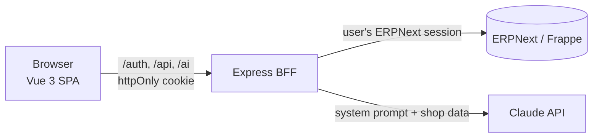

# 🌸 Flower Shop Dashboard

An AI-powered sales dashboard for **ERPNext**. Business owners sign in with their ERPNext account, see live sales insights, and ask questions about their data in plain language.

Built with **Vue 3**, **Express (BFF)**, **ERPNext/Frappe**, and the **Claude API**.


## ✨ Features

- **Live ERPNext data**: sales invoices, items, and customers through the Frappe REST API
- **Sales insights**: total sales, average order, top customer, sales per month, top products, sales by category
- **AI assistant**: ask questions like *"Which customer spent the most?"*, answered from the shop's real data
- **Login with ERPNext accounts**: no separate user system
- **Role-based access**: only users with the `Dashboard Reader` role can open the dashboard
- **Per-user permissions**: every request runs as the logged-in user, so ERPNext's own permissions apply
- **Responsive design**: works on desktop and mobile

## 🏗️ Architecture



The browser never talks to ERPNext or Claude directly. A small **Backend-for-Frontend (BFF)** server:

- Logs users in through ERPNext and keeps their ERPNext session **server-side**
- Gives the browser only a signed **httpOnly** session cookie
- Forwards **read-only** requests to an **allow-list** of DocTypes
- Checks the user's role at login and every 5 minutes
- Holds the Claude API key and builds the AI prompt on the server

## 🔐 Security highlights

| Concern | Solution |
|---|---|
| Secrets in the frontend | All keys live on the server only; nothing secret in browser code |
| CORS | Same-origin BFF instead of calling ERPNext from the browser |
| Token theft via XSS | `httpOnly`, `SameSite=Lax` session cookie |
| Session fixation | Session ID regenerated after login |
| Brute force | Login rate limiting |
| User enumeration | Same error for unknown user and wrong password |
| Over-privileged access | Requests run as the real user; read-only methods; DocType allow-list |
| Open redirects | Post-login redirects restricted to internal paths |
| Prompt injection | Data wrapped in tags and explicitly marked as non-instructions |
| XSS from AI output | Answers rendered as text, never `v-html` |
| API cost abuse | Rate limiting on the AI endpoint |

## 🛠️ Tech stack

**Frontend:** Vue 3 (Composition API), Vue Router, Chart.js (vue-chartjs), Vite
**Backend:** Node.js, Express, express-session, http-proxy-middleware, express-rate-limit
**ERP:** ERPNext v16 on Frappe Framework, running in Docker
**AI:** Claude API (Anthropic SDK)

## 🚀 Getting started

### Prerequisites
- Node.js 20.18
- Docker Desktop
- An ERPNext instance (local setup below)

### 1. Run ERPNext locally
```bash
git clone https://github.com/frappe/frappe_docker
cd frappe_docker
docker compose -f pwd.yml up -d
```
Open `http://localhost:8080` and log in as `Administrator` / `admin`.

### 2. Configure ERPNext

**Role:** create a role `Dashboard Reader` with **Read** permission on `Sales Invoice`, `Customer`, and `Item` (Role Permission Manager).

**Server Script:** enable server scripts:
```bash
docker compose -f pwd.yml exec backend bench set-config -g server_script_enabled 1
docker compose -f pwd.yml restart backend
```
Then create a Server Script with **Script Type** `API` and **API Method** `get_my_roles`:
```python
user = frappe.session.user

if user == "Administrator":
    roles = frappe.get_all("Role", pluck="name")
else:
    roles = frappe.get_all(
        "Has Role",
        filters={"parent": user, "parenttype": "User"},
        pluck="role",
    )

frappe.response["message"] = {"user": user, "roles": roles}
```

**Users:** give the `Dashboard Reader` role to anyone who should access the dashboard.

### 3. Run the dashboard
```bash
git clone https://github.com/RahmaAtef298/flower-dashboard
cd flower-dashboard
npm install
cp .env.example .env.local   # then fill in the values
npm run dev:all
```
Open `http://localhost:5173`.

### Scripts

| Command | Description |
|---|---|
| `npm run dev:all` | Run the BFF server and Vite together (development) |
| `npm run build` | Build the frontend into `dist/` |
| `npm start` | Run the production server (serves `dist/` and the API) |

## 📁 Project structure

```
server/
├── index.js     # Express app: sessions, guards, proxy, static files, SPA fallback
├── auth.js      # Login, logout, session check, role verification
├── ai.js        # AI chat endpoint: data loading, prompt, validation, rate limit
└── erp.js       # Server-side ERPNext client
src/
├── api/         # Browser-side API calls (auth, erp, ai)
├── components/  # Dashboard, charts, stat cards, chat, invoices table
├── router/      # Routes and navigation guard
├── stores/      # Shared auth state
├── utils/       # Formatting and sales calculations
└── views/       # Login and dashboard pages
```

## 💭 Design decisions and trade-offs

- **BFF instead of direct API calls:** keeps secrets off the client, avoids CORS, and gives one place for security rules.
- **Client-side aggregation:** fine for small datasets. For large data, aggregation should move to the server (Frappe `group_by` queries or a whitelisted Python method).
- **Full data in the AI prompt:** simple and accurate for a small shop. At scale, the next step is **tool use**: the model calls functions like `get_sales_by_month` instead of receiving all data.
- **Role re-check every 5 minutes:** balances security (revoked access takes effect quickly) with performance (no extra ERPNext call on every request).
- **In-memory sessions:** fine for development. Production should use a Redis session store.

## 🗺️ Roadmap

- [ ] Move aggregation to a custom Frappe app with whitelisted methods
- [ ] AI tool use (function calling) for large datasets
- [ ] TypeScript with types generated from DocType metadata
- [ ] Redis session store and production deployment
- [ ] Date range filters

## 👩‍💻 Author

**Rahma** · Frontend Engineer (7 years) · Vue, React, Angular, Node.js · ERPNext/Frappe · AI integration
[LinkedIn](https://linkedin.com/in/rahma-atef-42896711b) · [GitHub](https://github.com/RahmaAtef298)